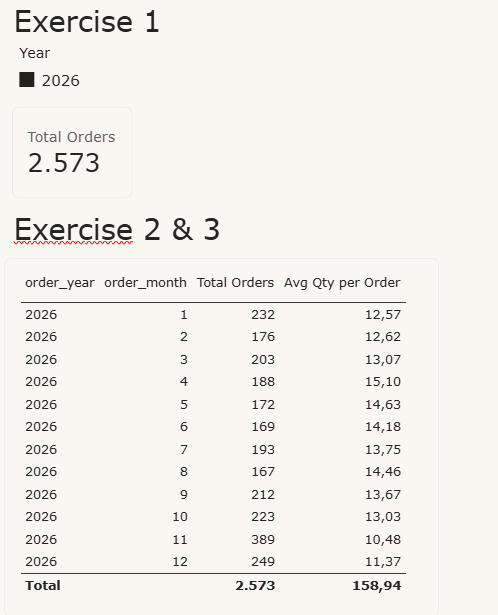

# E-Commerce Analytics Pipeline & BI Solution

> **Take-Home Challenge — BI / Analytics Engineer**
>
> End-to-end modern data stack implementation using **dbt**, **GitHub**, and **Microsoft Fabric** (Lakehouse, Spark Notebook, Data Pipeline, dbt Job, Warehouse, Semantic Model, and Power BI).

🔗 **GitHub Repository:** [https://github.com/JorgeLlorente/analytics-engineering-challenge](https://github.com/JorgeLlorente/analytics-engineering-challenge)

🔗 **Live Dashboard (`Sales & Orders Report`):** [Marketing & Sales Intelligence](https://app.fabric.microsoft.com/groups/b5c6bd3f-4df4-4ad0-8c03-fc406733b51a/reports/4cb8ba29-f8ff-4801-bfd7-c2461dce632f/cc470828e6474105629f?ctid=188b450b-7545-493f-9096-854ed4977730&language=en-GB&experience=fabric-developer)
📊 **Data Coverage:** July 2025 – December 2026

---

## 1. Executive Summary & Architecture Overview

This project delivers a production-ready analytics engineering pipeline and executive BI solution designed to help an e-commerce marketing team monitor daily performance, understand customer retention dynamics (`New`, `Returning`, `VIP`), and analyze product catalog profitability.

While the challenge prompt references BigQuery and LookML as reference technologies, this solution implements the exact same **Medallion + Star Schema + Governed Semantic Layer** architectural principles natively within **Microsoft Fabric** and **dbt**, demonstrating portability, CI/CD governance, and production best practices.

### End-to-End Data Flow & Fabric Artifacts

```text
[Raw Excel Files] (orders_recrutement.xlsx, sales_recrutement.xlsx)
        │
        ▼  (Orchestrated by Fabric `Pipeline` + `Load Tables` Notebook)
[Bronze Layer — Fabric Lakehouse: `bronze_lh`]
  ├── bronze.raw_orders  (exposed via `bronze_lh` SQL Analytics Endpoint)
  └── bronze.raw_sales
        │
        ▼  (Fabric `dbt build` Job synced with GitHub)
[Silver & Gold Layers — Fabric Warehouse: `DWH`]
  ├── Staging (Views):       stg_orders, stg_sales
  ├── Intermediate (Views):  int_orders_qty, int_customer_order_segments
  └── Marts (Star Schema):   fact_orders, fact_sales, dim_customers, dim_products, dim_date
        │
        ▼
[Semantic Layer — Fabric Semantic Model: `Sales DS`]
  └── Star Schema relationships + Centralized DAX `Metrics` table
        │
        ▼
[Presentation Layer — Power BI Report: `Sales & Orders Report`]
  └── E-Commerce Performance Hub (5 interactive pages)
```

### Microsoft Fabric Workspace Inventory

| Artifact Name | Fabric Item Type | Role in the Architecture |
| :--- | :--- | :--- |
| **`bronze_lh`** | Lakehouse (+ SQL Analytics Endpoint) | Stores raw ingested source files and exposes `raw_orders` and `raw_sales` tables for SQL querying. |
| **`Load Tables`** | Notebook | Handles raw data ingestion and table loading into the `bronze_lh` Lakehouse. |
| **`Pipeline`** | Data Pipeline | Orchestrates the end-to-end execution workflow (ingestion → dbt transformation → downstream refresh). |
| **`dbt build`** | dbt Job | Executes dbt models and generic/singular data quality tests directly from the GitHub repository against the Fabric Warehouse. |
| **`DWH`** | Warehouse | Hosts the transformed Silver (Staging/Intermediate views) and Gold (Star Schema Marts) layers. |
| **`Sales DS`** | Semantic Model | Governed BI semantic layer sitting on top of `DWH`, containing Star Schema relationships and centralized DAX measures. |
| **`Sales & Orders Report`** | Power BI Report | Executive 5-page dashboard consumed by the Marketing & Sales teams (also included as `.pbix` in the repo). |

---

## 2. Environments, Governance & CI/CD Strategy (Dev / Prod)

To mirror a real-world enterprise analytics setup rather than a one-off ad-hoc environment, the solution is structured across **two isolated Microsoft Fabric workspaces** backed by **GitHub** version control:

* **Source Control (`GitHub`):** All dbt SQL models, YAML configurations, tests, and documentation live in the public repository ([JorgeLlorente/analytics-engineering-challenge](https://github.com/JorgeLlorente/analytics-engineering-challenge)).
* **Development Environment (`DEV` Workspace):** Used for active model development, schema changes, local/cloud `dbt build` validation, and visual prototyping in Power BI without impacting business users.
* **Production Environment (`PROD` Workspace):** Mirrors the exact Fabric artifact structure (`bronze_lh`, `Load Tables`, `Pipeline`, `dbt build`, `DWH`, `Sales DS`, `Sales & Orders Report`) and runs strictly against validated, tested code.
* **Environment-Agnostic dbt Code:** Source databases and schemas are parameterized via dbt variables (`{{ var('bronze_database') }}`, `{{ var('bronze_schema') }}`) and `ref()` / `{{ this }}` macros, allowing seamless promotion from `DEV` to `PROD` without hardcoding workspace-specific paths.

---

## 3. Part 1: Data Transformation Pipeline (dbt)

The dbt project is organized following modern analytics engineering standards to maximize modularity, maintainability, and DRY (*Don't Repeat Yourself*) principles.

### Project Structure

```text
├── dbt_project.yml
├── models/
│   ├── staging/
│   │   ├── _sources.yml                     # Bronze source definitions & null checks
│   │   ├── stg_orders.sql                   # Type casting & column standardization (View)
│   │   └── stg_sales.sql                    # Header cleanup, filtering & casting (View)
│   ├── intermediate/
│   │   ├── int_orders_qty.sql               # Product quantity aggregation per order (Ex. 4)
│   │   └── int_customer_order_segments.sql  # Rolling 12m segmentation logic (Ex. 5 & 6)
│   └── marts/
│       ├── _marts.yml                       # Model/column documentation & generic tests
│       ├── fact_orders.sql                  # Incremental order-level fact table
│       ├── fact_sales.sql                   # Incremental line-item fact table
│       ├── dim_customers.sql                # Customer dimension
│       ├── dim_products.sql                 # Product dimension
│       └── dim_date.sql                     # Calendar dimension for Time Intelligence
└── tests/
    └── assert_orders_match_sales.sql        # Singular reconciliation test (severity: warn)
```

### Modeling Layers & Design Choices

1. **Bronze / Sources (`_sources.yml`):**
   * References `bronze_lh` via dbt variables (`var('bronze_database')`, `var('bronze_schema')`) to support multi-environment (`DEV` / `PROD`) execution.
   * Enforces baseline `not_null` checks on critical source columns.

2. **Staging (`stg_orders`, `stg_sales` — Materialized as `view`):**
   * Performs light cleaning, column renaming, and explicit type casting without business logic.
   * `stg_sales` cleans raw Excel ingestion artifacts (`Prop_0`–`Prop_5`, filtering out residual header rows such as `'date_date'` and `'Column1'`).
   * **Decimal Precision:** `net_sales` is explicitly cast to `decimal(18, 4)` rather than `decimal(18, 2)` to preserve source precision and eliminate cumulative rounding drift across line items (see *Data Quality Findings* below).

3. **Intermediate (`int_orders_qty`, `int_customer_order_segments` — Materialized as `view`):**
   * Isolates complex reusable business logic before joining into final Marts.
   * **`int_orders_qty` (Exercise 4):** Aggregates `sum(qty)` at the `order_id` grain.
   * **`int_customer_order_segments` (Exercises 5 & 6):** Computes a rolling 12-month prior order count per customer using a self-join (`b.date_date >= dateadd(day, -365, a.date_date) and b.date_date < a.date_date`) and classifies each order into:
     * **`New`**: `0` prior orders in the past 12 months.
     * **`Returning`**: `1–3` prior orders in the past 12 months.
     * **`VIP`**: `4+` prior orders in the past 12 months.

4. **Marts / Gold Layer (`DWH` — Star Schema):**
   * **`fact_orders` (1 row per `order_id`):** Joins `stg_orders`, `int_orders_qty`, and `int_customer_order_segments`. Retains full historical coverage (2025–2026) rather than hard-filtering to 2026 so downstream BI can dynamically compute YoY comparisons and answer Exercises 1–6 via filters.
   * **`fact_sales` (1 row per `order_id` + `products_id`):** Enables product-level and basket-composition analysis.
   * **`dim_customers`, `dim_products`, `dim_date`:** Conformant dimensions enabling clean 1-to-many Star Schema relationships and preventing many-to-many ambiguity in `Sales DS`.

### Mapping Challenge Exercises (1–6)

Rather than materializing rigid pre-aggregated tables that restrict BI slicing, Exercises 1–6 are solved cleanly through the Star Schema and Semantic Layer:

| Exercise | Requirement | Implementation Strategy |
| :--- | :--- | :--- |
| **Ex. 1–3** | Total orders (2026), monthly orders (2026), avg products/order per month (2026) | Dynamically computed in `Sales DS` over `fact_orders` (`Total Orders`, `Units per Order (UPT)` filtered by `Year = 2026`). |
| **Ex. 4** | Order table (2025–2026) with `qty_product` | Materialized in `fact_orders` via `int_orders_qty`. |
| **Ex. 5–6** | Rolling 12m customer order segmentation (`New`, `Returning`, `VIP`) for 2026 orders | Calculated in `int_customer_order_segments` and exposed in `fact_orders.order_segmentation` (filterable by `Year = 2026` or any period). |

### Exercise 1–3 Results

The following Power BI view shows the total 2026 orders and the monthly order and average quantity metrics:



### Performance, Cost & Scalability Considerations

Designed with hypothetical billion-row scale in mind:

* **Incremental Materialization:** Both `fact_orders` (`unique_key = 'order_id'`) and `fact_sales` (`unique_key = ['order_id', 'products_id']`) are materialized as `incremental`.
* **Late-Arriving Data Protection:** The incremental filter uses `where date_date >= (select max(date_date) from {{ this }})` (`>=` instead of `>`). This reprocesses only the latest loaded day plus new dates, minimizing compute/scan costs while safely handling late-arriving intraday orders via upsert (`MERGE`) without creating duplicates.

---

## 4. Data Quality & Key Findings

Data integrity is automated inside the `dbt build` job via both **generic dbt tests** (`not_null`, `unique`, `relationships`) and a **singular reconciliation test** (`tests/assert_orders_match_sales.sql`) that cross-checks order headers (`stg_orders`) against aggregated line items (`stg_sales`).

Running this reconciliation uncovered **three notable data anomalies** in the source files:

1. **Date Range Discrepancy:**
   The challenge prompt mentions `2022–2023` in the *Data* section while Exercises 1–6 reference `2025–2026`. Inspection of the raw Excel files confirmed that actual transaction dates span **July 2025 to December 2026**. All models and BI visuals adapt dynamically to the actual dataset dates.

2. **Rounding Drift Resolved (356 Orders → 0):**
   Raw `net_sales` values contain 4 decimal places (e.g., `38.7005`). Initially casting to `decimal(18, 2)` in staging caused rounding discrepancies (`> 0.01 €`) across **356 orders** (~5–6 € total variance between `fact_orders` and `fact_sales`). Upgrading staging casts to `decimal(18, 4)` eliminated all 356 rounding warnings.

3. **Orphan Order in `sales` (`order_id = 5361303`):**
   All **3,661 orders** in `orders_recrutement.xlsx` match `sales_recrutement.xlsx` to the exact cent (`0.0000 €` variance). However, `sales` contains **1 orphan order** (`order_id = 5361303`, `customer_id = 1382673`, `date_date = 2026-12-31`, `net_sales = 47.0833`, `qty = 1`) with no corresponding header in `orders`.
   * `assert_orders_match_sales` is configured with `severity = 'warn'` so it alerts engineering (`WARN 1`) without blocking daily pipeline execution, preserving full transparency of source anomalies.

---

## 5. Part 2: Semantic Layer (`Sales DS`)

The Microsoft Fabric Semantic Model (`Sales DS`) sits directly on top of the Gold Star Schema in `DWH` and acts as the governed single source of truth for self-service BI and executive reporting.

### Key Architectural Practices

* **Dedicated `Metrics` Table:** All DAX measures are centralized in a clean measures table (with technical placeholder columns hidden) to keep business logic DRY and discoverable.
* **Fact-Grain Separation:** Order-level KPIs (`Total Net Sales`, `Total Orders`, `Avg Order Value`, `Units per Order (UPT)`) query `fact_orders`, while product-level KPIs (`Product Net Sales`, `Product Units Sold`, `Active Products`, `Avg Unit Price`, `Avg Distinct Products per Order`, `% Product Revenue Share`) query `fact_sales` so filters from `dim_products` evaluate accurately without fan-out or double-counting.
* **Dynamic Customer Segmentation:** `order_segmentation` (`New`, `Returning`, `VIP`) is exposed as a first-class slicing/pivoting attribute across all revenue, order, and customer metrics, including dedicated measures (`% VIP Revenue Share`, `Orders New/Returning/VIP Customers`).
* **Time Intelligence:** Powered by `dim_date`, enabling `Net Sales LY` and `Net Sales MoM %`.
* **AI / Conversational Analytics Readiness:** Structured for natural-language querying (e.g., Power BI Copilot / Q&A) through unambiguous business naming, hidden technical keys, and clean 1-to-many Star Schema paths to prevent AI hallucinations.

---

## 6. Part 3: BI Dashboard Design (`Sales & Orders Report`)

Designed for the Marketing team's daily operational monitoring, `Sales & Orders Report` uses a cohesive executive visual theme (slate blue header, warm neutral canvas, and petrol/mustard/terracotta accents mapped consistently to `New`, `Returning`, and `VIP`).

### Report Pages

1. **Home — `Marketing & Sales Intelligence`:**
   Custom-designed landing page with intuitive navigation buttons to jump directly into each analytical view.
2. **General Overview:**
   * **KPI Strip:** Total Net Sales (`269K €`), Total Orders (`3,661`), Total Units Sold (`47,728`), Active Customers (`1,716`), Units per Order (`13.04`), Avg Order Value (`73.49 €`).
   * **Revenue Trend:** Monthly `Total Net Sales` vs. `Net Sales LY` to track seasonality (e.g., November peak) and YoY growth.
   * **Segment Mix:** Donut chart of Net Sales by `Order Segmentation` (`New` 39%, `Returning` 32%, `VIP` 29%) plus comparative breakdown.
3. **Customer Segmentation:**
   * Monthly stacked bar chart tracking revenue contribution by `New`, `Returning`, and `VIP` over time.
   * Side-by-side comparison of **AOV & UPT by Segment**, highlighting that VIP orders deliver significantly higher basket value (`98.40 €` AOV / `21.08` UPT) than New orders (`60.45 €` AOV / `8.77` UPT).
   * Detailed customer-segment table with drill-through navigation.
4. **Customer Analysis (Drill-Through Page):**
   * Deep-dive view for any selected `Customer ID` showing lifetime Net Sales, Total Orders, First & Last Order Dates, chronological order history, and **Benchmark Cards** comparing the customer's AOV and UPT directly against Global averages.
5. **Product Analysis:**
   * **Catalog KPIs:** Product Net Sales, Product Units Sold, Active Products (`9,196`), Avg Unit Price (`5.64 €`), Avg SKUs per Order (`7.74`).
   * **Top 10 Products** by volume/revenue.
   * **Price vs. Volume Scatter Plot:** Identifies high-volume entry products vs. high-value star products.
   * **Detailed Product Table:** Full SKU-level breakdown with revenue share and order count.

---

## 7. How to Run Locally

### Prerequisites

* Python 3.10+ with `dbt-fabric` installed
* Configured `~/.dbt/profiles.yml` pointing to your Microsoft Fabric `DWH` (Dev or Prod target)

### Execution Commands

```bash
# 1. Clone the repository
git clone https://github.com/JorgeLlorente/analytics-engineering-challenge.git
cd analytics-engineering-challenge

# 2. Verify connection to Microsoft Fabric
dbt debug

# 3. Run full build (models + generic & singular tests)
dbt build

# 4. Run incremental models from scratch (if schema changes)
dbt run --select fact_orders fact_sales --full-refresh

# 5. Inspect any data quality warnings (e.g., orphan order 5361303)
dbt test --select assert_orders_match_sales --store-failures
```